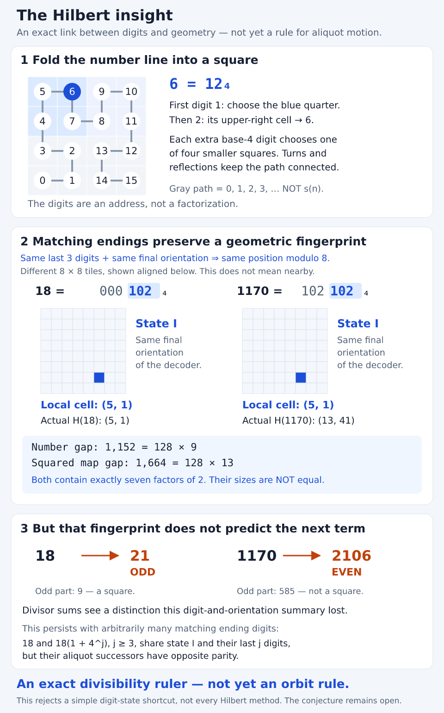

# The Hilbert insight, in words and pictures

**The useful insight is an exact connection between base-four digits and
geometric divisibility. It is not yet a rule controlling aliquot orbits.**



[Open the scalable diagram](results/hilbert-explained.svg).
The explanation below also supplies a text alternative to the picture.

## 1. Give every number an address on a map

Start with the ordinary number line, 0, 1, 2, 3, … . A Hilbert path folds it
into a square grid: visit every cell once, always moving to a neighboring cell.
Keep extending the construction to larger squares.

Base four is natural because every square divides into **four** smaller squares.
The first digit selects a large region; the next selects a smaller region
inside it; and so on. Turns and reflections keep the path connected.

For example, **6 = 12 in base four**. In the diagram's 4-by-4 grid, digit 1
chooses the upper-left quarter, and digit 2 chooses its upper-right cell.
That cell is labelled 6. The decoder tracks the turns/reflections in an
*orientation state*; two numbers need not finish in the same state.

There are two different motions to keep separate:

- **Following the gray Hilbert path** means counting n, n+1, n+2, … .
- **Following an aliquot arrow** means jumping from n to s(n), the sum of its
  proper divisors. That jump need not go to a neighboring cell.

H(n) is the coordinate assigned to the **value n**, not to its iteration number.
The figure uses the same fixed, even-padded convention as the research note.

## 2. The surprising part: matching endings leave a geometric fingerprint

Leading digits select nested regions. **Trailing digits do something different.**
If two numbers have the same final orientation state, matching trailing
base-four digits imply matching low binary coordinate bits.

Here is a concrete example, with harmless leading zeros added:

```text
  18 = 000 | 102  (base four)
1170 = 102 | 102  (base four)
             ↑
       same last 3 digits
```

Both decoders finish in orientation state I. Three matched base-four digits
mean both coordinates match modulo 2³ = 8:

```text
H(18)   = ( 5,  1) = (0,  0) + (5, 1)
H(1170) = (13, 41) = (8, 40) + (5, 1)
                               ↑
                    same cell inside different 8-by-8 tiles
```

This is **digital similarity, not physical closeness**. The diagram aligns the
two different tiles just to compare their local cell positions.

The full Hilbert identity is more precise: for two distinct numbers with the
same final orientation, their numerical difference and their **squared** map
distance contain exactly the same number of factors of two. Here:

```text
number gap       = 1170 − 18             = 1152 = 128 × 9
squared map gap  = (13 − 5)² + (41 − 1)² = 1664 = 128 × 13
```

Since 128 = 2⁷ and both 9 and 13 are odd, both gaps contain exactly seven
factors of two. Their sizes are **not** equal. This is an exact divisibility
identity, not a visual resemblance or a claim that distances shrink.

## 3. Why that has not solved the aliquot problem

The hope was that this compact geometric information would constrain the
next aliquot jump—perhaps enough to prove eventual descent or a repeatable
growing pattern. But the divisor-sum rule needs information this summary lost:

```text
  18 →   21   (odd)
1170 → 2106   (even)
```

These are two separate source–successor pairs, not one orbit joining 18 to 1170.
For 18 the proper divisors are 1, 2, 3, 6, 9, summing to 21.
For 1170, its factorization is 2 × 3² × 5 × 13; its full divisor sum is
3 × 13 × 6 × 14 = 3276, so its proper-divisor sum is 3276 − 1170 = 2106.

There is a clean reason for the parity difference. Remove all factors of 2:
18 leaves the square 9; 1170 leaves the nonsquare 585. For an even source,
its successor is odd exactly when this odd part is a square.

This failure persists beyond the pictured three digits. For every j≥3,
**18 and 18(1+4^j)** share their last j base-four digits and state I, but their
successors have opposite parity. The [written argument](HILBERT.md#4-complete-orientation-plus-finite-suffixes-still-cannot-give-the-next-bit)
proves this for all j; a large finite scan is not the reason we know it.

So increasing a *fixed* amount of trailing-digit information is not enough,
even if we also keep the complete orientation state. This does not rule out
methods that retain more factorization information or use suitable multistep
returns. It rules out this particular shortcut.

**In one sentence: Hilbert gives us an exact divisibility ruler for the map,
but not yet a rule telling us where the aliquot arrows must eventually go.**

## Reproduce the illustration

```sh
# Standard-library-only SVG generation:
python3 scripts/build_hilbert_explainer.py

# Optional convenience PNG; not a math/runtime/test dependency:
uv run --no-project --with resvg-py==0.5.0 python scripts/build_hilbert_explainer.py --png

# Check the SVG and the PNG's embedded source hash:
python3 scripts/build_hilbert_explainer.py --check
python3 -m unittest discover -s tests -p test_hilbert_explainer.py -v
```

The SVG is reproducible without added dependencies. PNG rasterization can vary
with installed fonts; its embedded hash identifies the SVG used. The PNG was
visually inspected. Exact coordinates and sums come from the existing Python
module, not from measuring image pixels. These explanatory artifacts remain
outside `site/`; no website deployment or conjecture resolution is implied.
