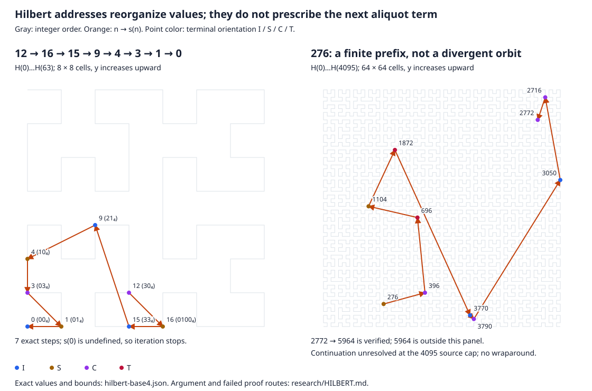

# Hilbert paths and base four: a proof attempt and its stopping point

**Result:** the Hilbert pair law transfers to the *labels* of aliquot values,
but does not force a forbidden event on their orbits. The proposed radial
rank fails. Even retaining the complete Hilbert terminal state together with
arbitrarily many low base-four digits does not determine successor parity.
**No proof/disproof, escaping seed, or novelty is claimed.**

For an accessible introduction, see the [plain-English visual walkthrough](HILBERT-EXPLAINED.md).

This follows the user's Hilbert/base-four suggestion rather than enlarging the
previous censuses. References consulted were the [aliquot synthesis](SYNTHESIS.md),
[2-adic attempt](TWO-ADIC.md), [base-four/core-restoration attempt](FOUR-ADIC.md),
the Explore/Reverse/Graph/Lengths implementations and documented bounds, and
[the coalescence attempt in unmerged PR #11](https://github.com/q5m-ai/aliquot/blob/22cf5318337b6a1cb4851d01757f8cd4bbf19763/research/COALESCENCE.md).
That PR is a reference, not a dependency or an implied merge.

The geometric reference is the actual
[Hilbert terminal-state pair law](https://github.com/q5m-ai/erdos-193/blob/b156ed0039b5c1b028e210aa80d28d2644fad976/design/HILBERT-TERMINAL-STATE-PAIR-LAW.md),
not just an analogy with the later Gaussian-walk proof. Its construction and
written argument were read; its separate Lean build was **not** rerun here.
Use `tau` for terminal orientation, avoiding confusion with divisor sum `sigma`.

## 1. Fix the embedding before looking for patterns

For n >= 0, read its base-four digits most significant first, padding to an
**even** length with leading zeros. A digit selects a child corner

```text
q        0       1       2       3
c_q    (0,0)   (0,1)   (1,1)   (1,0)
r_q      S       I       I       T
```

Here I is identity, S swaps coordinates, T swaps and complements both bits,
and C complements both bits. In incoming state g, emit the coordinate-bit pair
`g(c_q)`, then replace g by `g composed with r_q`. Start in I. The emitted bits
are the binary coordinates H(n)=(x(n),y(n)); the final state is tau(n).

S and T are commuting involutions, with ST=C. Consequently

```text
tau(n) = S^(number of 0 digits mod 2) T^(number of 3 digits mod 2).
```

Two extra leading zeros emit zero coordinate bits and return the state to I,
so this defines **one infinite map**, not a differently rotated picture each
time the display grows. It is the nested-even Hilbert bijection from the
nonnegative integers to the nonnegative lattice. Consecutive integer labels
are grid neighbors. H(0) is allowed as an endpoint, but s(0) remains undefined.

The aliquot orbit is `n_(k+1)=s(n_k)`. We plot **H(n_k)**, not H(k). Orange
arrows join actual successor values; they need not be Hilbert unit edges.
Plotting `(H(k),n_k)` instead would make the planar motion local by definition,
but would provide no identity relating the gaps in k to the gaps in n_k.
Neither convention is an arithmetic result by itself.



The right panel retains the verified successor 5964 in the
[exact data](results/hilbert-base4.json), outside its 0..4095 display prefix.
It does not fold that value modulo 4096. Only the continuation is unresolved
at this deliberately small bound. This is a generated source-research figure,
not a new deployed website view or a claim about the fate of 276.

## 2. The strongest geometric identity that actually transfers

The reference's same-terminal-state theorem states, for distinct m,n,

```text
tau(m)=tau(n)  =>  v2(||H(n)-H(m)||^2) = v2(|n-m|).        (1)
```

Why: let j be the first differing base-four position from the right. Equal
terminal states let us rewind the shared low suffix through the reversible
orientation transitions. Below j the coordinate bits match. At j an odd digit
difference changes one coordinate bit, while a difference of 2 changes both.
The squared norm therefore has valuation 2j or 2j+1 respectively, exactly as
the integer gap does. This is an all-length digit argument, not a numerical fit.
The equivalent vector fingerprint and complete proof are in the cited source.
Without equal terminal states it need not hold: indices 1 and 5 have squared
chord length 10 but gap 4, whose 2-valuations are 1 and 2.

For an actual aliquot step with matching terminal states and s(n) != n, (1)
gives the **exact**, but not yet useful, identity

```text
v2(||H(s(n))-H(n)||^2) = v2(|sigma(n)-2n|).                (2)
```

For even n=2^a m with m odd, put b=v2(sigma(m)) and C=2^(a+1)-1.
The right side of (2), when nonzero, is

```text
b                                  if b < a+1,
a+1                                if b > a+1,
a+1 + v2(|C sigma(m)/2^(a+1) - m|)  if b = a+1.
```

This is the usual unequal-valuation/cancellation rule. It is a valuation of
**displacement**, not of the next value. The factorization-dependent supply
b still occurs; it has not been removed by the embedding. Perfect fixed points
have zero displacement and must be handled separately, not assigned a finite
valuation. For odd n, (2) still applies under its stated guards.

An escaping orbit would have infinitely many occurrences of at least one of
the four terminal states. Every pair in that subsequence would obey (1), just
as any unrelated collection of integer labels does. This does not force equal
values, bounded gaps in orbit time, collinearity, or arithmetic closure.

The Erdős construction **selects** integer indices to maintain a terminal
state, and excludes collinearity of their lifts `(H(n),n)`. Aliquot iteration
cannot choose its next index. More importantly, escape does not imply that
three such lifts are collinear. Even the unrelated escaping sequence n_k=k+1
has this same geometric pair law on each state class. That is not an aliquot
counterexample; it shows why geometry alone cannot supply the contradiction.
Nor can one push a divisor sum through H as a linear operation:
`H(3)+H(5)=(0,4)`, whereas `H(8)=(2,2)`.

Even equally spaced same-state returns on a real orbit do not force it:

```text
30 -> 42 -> 54 -> 66 -> 78,
H(30)=(4,2), H(54)=(2,4), H(78)=(0,10), all with state C.
```

The sampled integer gaps are both 24, but the planar chords are (-2,2) and
(-2,6), not parallel. Their squared lengths 8 and 40 have valuation 3; the
endpoint squared length 80 has valuation 4. This agrees with the valuations
of 24,24,48, rather than contradicting (1). Orbit-time gaps are 2,2,4 instead;
substituting them into (1) would be an error.

### Try to propagate through the base-four recursion

Let epsilon(n)=0 in states I,S and 1 in states C,T. Appending two zero digits
preserves the terminal state and emits two copies of (epsilon,epsilon), giving

```text
H(16n) = 4 H(n) + 3 epsilon(n) (1,1),    tau(16n)=tau(n).
```

That is a genuine finite-state scaling rule. But for n=2^a m, m odd, a>=0,
multiplicativity gives

```text
s(16n) = 16 s(n) + 15 sigma(m).
```

Indeed sigma(16n)=(2^(a+5)-1)sigma(m). Subtract 16n and compare with
16[(2^(a+1)-1)sigma(m)-n]. The additional 15 sigma(m) is essential; aliquot
iteration does not commute with Hilbert scaling. Its size and base-four carries
require the odd-part divisor sum, not just the geometric state. Adding that
sum as a tag would still require a theorem propagating the next such tag.
This is the precise missing arithmetic in a simple self-similarity attempt.

## 3. Test a genuine candidate for descent, not just the picture

Consider the nonnegative integer rank `R(n)=||H(n)||^2`. All of these exact
steps have **matching state I** at their endpoints:

| Step | H(n) -> H(s(n)) | R(n) -> R(s(n)) | Meaning |
| --- | --- | --- | --- |
| 15 -> 9 | (3,0) -> (2,3) | 9 -> 13 | A numerical decrease can move outward. |
| 72 -> 123 | (2,10) -> (5,8) | 104 -> 89 | A numerical increase can move inward. |
| 24 -> 36 | (6,2) -> (6,4) | 40 -> 52 | Not even same-state steps always descend. |

Thus R is not a one-step descent rank, nor does it always decrease at the
next positive-time return to the same terminal state: 24 -> 36 is already
such a return. Conversely, state I is not a growing closed class:
`24 -> 36 -> 55 -> 17 -> 1 -> 0`, with tau(55)=S, and 15 -> 9 already decreases.

The failure cannot be removed by discarding finitely many small sources.
For every r>=0, put t=4^r and n=24*16^r. Then

```text
s(n)=40t^2-4,
tau(n)=tau(s(n))=I,
H(n)=(6t,2t),    H(s(n))=(6t,6t-2),
R(s(n))-R(n)=4(4t-1)(2t-1)>0.
```

**Derivation.** Here n=3*2^(3+4r), so the divisor-sum product gives the stated
successor. The source coordinates follow by repeatedly applying the scaling
rule in state I. The successor's even-padded word is `021 [2r threes] 0`:
its value is 40*16^r-4. The prefix `021` emits coordinate prefixes (3,2) and
leaves state S. The even run of threes alternates states S,C and emits (0,1)
each time, giving (3t,3t-1) in state S. The final zero doubles both coordinates
and returns to I, proving the displayed formulas. Squaring gives the difference.

These are arbitrarily large *separate* first-return pairs, not one infinite
orbit. Positive state-dependent weights and state-dependent additive constants
cannot make R decrease on them because both endpoints have state I. This
rejects these candidates, not every factor-aware rank or return map.

The nested Hilbert shells cannot manufacture an orbit bound. Precisely,

```text
n < 16^r  iff  max(x(n),y(n)) < 4^r,     r >= 0.
```

The even-order grid of order 2r fills exactly that square. Consequently,
bounding the Hilbert coordinates of a whole orbit is equivalent to bounding
its integers. An escape eventually leaves every such square. A bounded
normalized picture or a modulo-4^K plot loses that distinction and can create
false-looking recurrences. A useful Hilbert rank would need a *new arithmetic
reason* for descent, not just properness of the coordinate change.

## 4. Complete orientation plus finite suffixes still cannot give the next bit

[Note 02](TWO-ADIC.md#3-an-elementary-obstruction-to-a-continuous-2-adic-map)
already obstructs a purely residue-based transition rule. The extra Hilbert
state is genuinely not a fixed suffix, so it deserves its own test.

**Claim.** For every K >= 1 there are positive a,b with the same residue modulo
4^K and the same Hilbert terminal state, but s(a),s(b) have different parity.
Indeed we can always take a=18 and b=18(1+4^j), for any j >= max(K,3).

**Proof.** Write b_j=18(1+4^j). Then b_j-18=18*4^j, so the low K digits agree.
The even-padded word for 18 is `0102`, with two zeros and no threes: tau(18)=I.
For j>=3 the *unpadded* word for b_j is

```text
102 [j-3 zero digits] 102.
```

It has length j+3, with j-1 zeros and no threes. If j is odd, the length and
zero count are both even. If j is even, padding adds one zero, again making
both counts even. Thus tau(b_j)=I for every such j.

The odd part of b_j is `9(1+4^j)`. Since

```text
(2^j)^2 < 1+4^j < (2^j+1)^2,
```

it is not a square. For an odd integer u, sigma(u) is odd exactly when u is
a square, as follows by multiplying its prime-power divisor sums. Therefore
sigma(b_j)=3 sigma(9(1+4^j)) is even. Both b_j and s(b_j) are even, whereas
s(18)=21 is odd. This proves the claim. No factorization or prime-distribution
hypothesis about the large b_j is needed. ∎

For example, `1170=102102_4` shares its last three digits and state I with
`18=000102_4`, yet `s(1170)=2106` is even and `s(18)=21` is odd.
Thus no function of `(n mod 4^K, tau(n))` can output s(n) mod 2 on all positive
integers, at any fixed K. The obstruction is not removed merely by recording
the Hilbert orientation alongside more suffix digits.

Scope: this does **not** exclude exact algorithms reading the whole integer,
factorization tags, restricted invariant domains, or adaptive multistep ranks.
Adding a square/non-square tag resolves this particular parity ambiguity but
would not prove that the next factorization guard renews. We do not infer a
universal impossibility theorem for Hilbert methods from this example.

## 5. The missing step, and where this attempt stops

There is a useful import: an exact orientation-aware encoding and pairwise
valuation law. There is no imported condition that forces an actual orbit to
violate that law. The attempted simple rank and finite digit-state dynamics
fail for the concrete reasons above.

A proof-directed continuation must supply at least one genuinely arithmetic
statement, for example:

- a well-founded rank, possibly on factor-aware Hilbert return states, with
  guaranteed finite strict descent unless the trajectory already resolves; or
- an explicit nonempty class closed under **actual** finite returns, with
  strictly increasing returned integer values, certifying one escaping orbit.

A counterexample class cannot be defined by assuming all its future guards
hold. A descent rank cannot be defined using unknown eventual resolution.
The existing supply/restoration conditions do not yet furnish either object.
**This is the stopping point, not a solution.** Increasing grid size, counting
more same-state transitions, or adding visual detail does not discharge it.

## 6. Reproduction and verification boundary

```sh
python3 scripts/build_hilbert_diagnostic.py
python3 scripts/build_hilbert_diagnostic.py --check
python3 -m unittest discover -s tests -p test_hilbert.py -v
```

- `aliquot/hilbert.py` uses Python integers throughout, including coordinates.
  The core has no new runtime dependency. Report integers use decimal strings.
- The report contains four named traces (12, 28, 220, 276), each limited to
  32 steps, inclusive source bound 4095, and 2,000,000 factorization work units
  per source. A known successor is retained even outside the source bound;
  work/step/source limits remain unresolved, never probable-prime shortcuts.
- The ambiguity examples are only j=3..8, largest factored source 1179666;
  the all-j claim rests on the written argument, not those six checks.
- Every computed divisor sum is independently recomputed by divisor-pair
  enumeration. The two algorithms share Python; this is not independent human
  mathematical review or proof-assistant verification.
- Tests compare the digit transducer to a separate low-to-high Hilbert
  rotation algorithm on 0..4095, check adjacency and orientation counts there,
  and check (1) for same-state pairs below 256. Scaling checks use sources
  1..64 and powers 16^r for r=1..3; norm-family checks use r=0..3, largest
  source 98304. They also check the five-term path from 30, large exact
  coordinates, boundary statuses, mismatch rejection, and artifact reproduction.
- The SVG is a deterministic two-panel illustration. Screen coordinates are
  rounded only for drawing; there is no wrapping or normalized orbit arithmetic.
  It and its JSON remain outside `site/`; no hosting or deployment is implied.

Two independent read-only Astra/max analyses reached the same propagation,
scaling, and descent barriers. They proposed different infinite norm-growth
families; the simpler 24*16^r family is derived above. There was no disagreement
on the stopping point. These are mathematical AI critiques, not human peer
review, formal verification, or an audit of the finished implementation.
